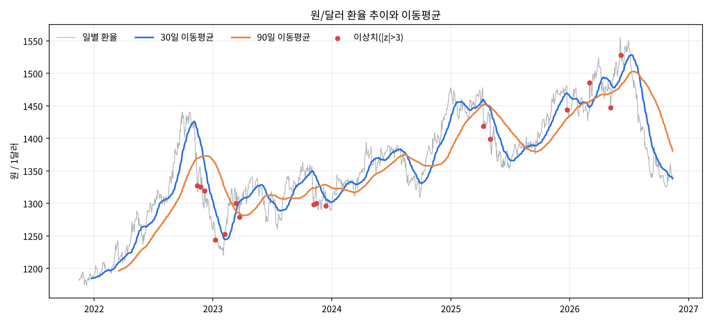
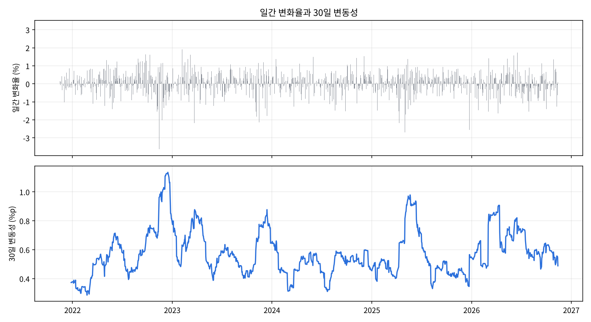
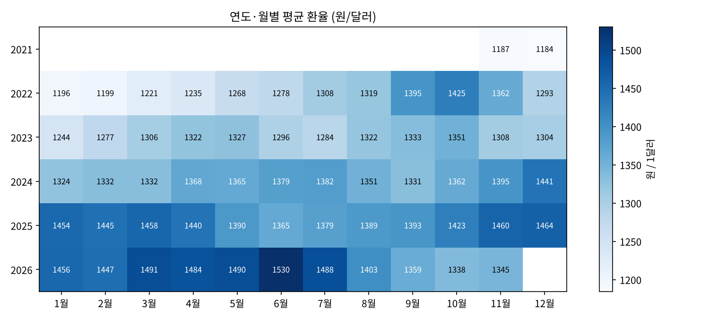

# 원/달러 환율 시계열 분석 리포트 (2021.11 ~ 2026.11)

## 1. 분석 주제
원/달러 환율(USD/KRW) 5년치 일별 데이터에서 **추세, 변동성이 커진 시기, 계절성 여부**를 찾고, 각각이 무엇을 의미하는지 해석한다.

## 2. 분석 질문
1. 5년간 환율의 큰 흐름(상승/하락 국면)은 어떻게 나뉘는가?
2. 변동성이 특히 컸던 시기는 언제이고, 그때 환율은 어떻게 움직였는가?
3. 월별·요일별로 반복되는 패턴(계절성)이 있는가?
4. 일간 변화율이 이례적으로 컸던 날(이상치)은 언제인가?

## 3. 데이터 설명
- **출처**: FRED(St. Louis 연방준비은행) 시리즈 `DEXKOUS` — South Korean Won to U.S. Dollar Spot Exchange Rate (일별)
- **기간**: 2021-11-15 ~ 2026-11-13
- **데이터 포인트**: 1,305개 (100개 이상 조건 충족)
- **컬럼**: `date`, `krw`(원/1달러)
- **결측치**: 55개(4.2%). 값이 비어 있는 날은 미국 공휴일 등 비거래일로 보이며, **직전 거래일 값으로 채움(ffill)**.
  - 이유: 휴장일에는 환율이 새로 형성되지 않으므로 직전 값 유지가 가장 자연스럽다. 삭제하면 날짜 간격이 불규칙해진다.
- **이상치**: 일간 변화율의 z-score 절댓값이 3을 넘는 날로 정의 → 16개. **삭제하지 않고 그래프에 표시만 함**.
  - 이유: 값이 틀린 것이 아니라 실제 시장 충격일일 가능성이 커서, 제거하면 중요한 정보가 사라진다.
- **기본 통계**: 최저 1,173.6원(2021-12-09), 최고 1,556.0원(2026-06-05), 평균 1,358.7원

## 4. 적용한 시계열 기법
| 기법 | 왜 썼는가 | 어떻게 |
|---|---|---|
| 이동평균(30일, 90일) | 일별 노이즈를 걷어내고 추세를 보기 위해 | `rolling(window).mean()` |
| 일간 변화율 | 환율 "수준"이 아니라 "변화의 크기"를 비교하기 위해 | `pct_change()*100` |
| 롤링 변동성 | 불안정한 시기를 찾기 위해 | 일간 변화율의 30일 표준편차 |
| 연도·월별 집계 | 계절성 확인 | `resample("MS").mean()`, 요일별 평균 변화율 |

## 5. 시각화
### 그림 1. 환율 추이와 이동평균 (이상치 표시)

### 그림 2. 일간 변화율과 30일 변동성

### 그림 3. 연도·월별 평균 환율

## 6. 인사이트

### 인사이트 1: 5년간 "오르고 꺾이기"를 세 번 반복했고, 저점이 계속 높아졌다
- **관찰**
  - 1차 상승: 2021-12-09 1,173.6원 → 2022-09-28 1,440.5원 (약 +22.7%). 이후 2022-10-21 1,440.3원 → 2022-12-30 1,260.2원으로 약 12.5% 하락 (그림 1).
  - 2차 상승: 2024-11-01 1,377.0원 → 2024-12-31 1,477.9원 (약 +7.3%). 2024년 연간 변화율은 +14.5%로 연도별 중 가장 크다.
  - 3차 상승: 2026-06-05에 5년 최고 1,556.0원. 이후 2026-06-30 1,548.8원 → 2026-09-09 1,339.8원으로 약 13.5% 급락.
  - 분석 시작일(1,181.6원, 2021-11-15)보다 마지막 날(1,336.6원, 2026-11-13)이 약 13% 높다. 저점도 1,173(2021) → 1,220(2023) → 1,325(2026)로 대체로 높아진 모습.
- **해석(가설, 초안)**: 2022년 상승은 미국 금리 인상에 따른 달러 강세 시기와 겹친다. 2024년 말 상승과 2025년 초 고점은 국내외 정치·통상 이슈 영향일 수 있다. 다만 이 데이터는 환율만 있어서 원인을 증명할 수 없고, **금리·뉴스와 함께 확인이 필요**하다. 2026년 상승·하락 원인은 직접 조사할 것.

### 인사이트 2: 변동성은 상시 일정하지 않고 "몰려서" 나타난다
- **관찰**
  - 30일 변동성 평균 0.57%p, 최대 1.14%p(2022-12-16), 최소 0.29%p(2022-02-23). 최대값은 평균의 약 2배 (그림 2).
  - 변동성이 0.85%p를 넘은 날이 몰린 달: 2022년 11~12월(32일), 2025년 5~6월(29일), 2026년 4월 등. 연도별 변동성 최고점은 2022-12-16(1.14), 2025-05-21(0.98), 2026-04-10(0.91).
  - 일간 변화율이 ±1%를 넘은 날은 전체 1,304일 중 111일(약 8.5%). 이상치 16개 중 가장 큰 것은 2022-11-14 −3.64%, 2026-03-03 +3.18%, 2025-05-02 −2.69%.
  - 변동성이 큰 구간은 그림 1에서 환율이 급등락하는 구간과 겹친다(예: 2022-11~12 급락, 2025-04~05 급락).
- **해석(가설, 초안)**: 큰 변화 하나가 아니라 며칠~몇 주 동안 큰 변동이 이어지는 "변동성 군집" 모습으로 보인다. 충격 뉴스가 나온 뒤 시장이 한동안 불안정하게 반응했을 가능성이 있다. 이상치 날짜의 실제 사건은 뉴스로 확인해야 한다.

### 인사이트 3: 뚜렷한 계절성·요일 효과는 찾기 어렵다 (추세가 훨씬 크다)
- **관찰**
  - 그림 3에서 같은 달끼리 비교하면 연도마다 방향이 제각각이다. 예를 들어 6월 평균은 2022년 1,278 → 2023년 1,296 → 2024년 1,379 → 2025년 1,365 → 2026년 1,530원. 월별 차이보다 연도별 수준 차이가 훨씬 크다.
  - 요일별 평균 일간 변화율은 −0.049% ~ +0.049%로 0에 가깝다. 일간 변화율의 표준편차가 약 0.59%이므로 요일 차이는 노이즈 수준.
- **해석(가설, 초안)**: 이 5년 환율은 계절 요인보다 금리·경기·정책 같은 큰 흐름이 좌우했을 가능성이 크다. 다만 5년이라는 짧은 기간(연도당 월별 표본이 1개)이라 계절성이 없다고 단정할 수는 없다.

### 인사이트 4: 이동평균 교차는 추세 전환을 "늦게" 알려준다
- **관찰**: 그림 1에서 2022-09 고점 이후 30일선이 먼저 꺾이고 90일선이 한참 뒤에 따라 내려간다. 2026-06 고점 이후에도 30일선이 90일선 아래로 내려온 뒤 환율은 이미 큰 폭으로 빠진 상태였다.
- **해석(가설, 초안)**: 이동평균은 노이즈를 줄여 주지만 반응이 느리다. 기간이 길수록 더 매끄럽고 더 늦다는 점이 확인된다.

## 7. 결론
- 질문 1: 환율은 5년간 큰 상승–하락을 세 번 겪었고(2022, 2024~2025, 2026), 저점이 점차 높아지는 모습이었다.
- 질문 2: 변동성이 가장 컸던 시기는 2022년 11~12월이며, 2025년 5~6월과 2026년 3~4월에도 높았다. 급변 시기에 변동성이 몰려 나타났다.
- 질문 3: 월별·요일별 반복 패턴은 뚜렷하지 않았다.
- 질문 4: 이상치는 16개이며 최대는 2022-11-14의 −3.64%였다.
- 종합하면, 환율 수준은 장기 추세와 몇 번의 충격 국면이 좌우했고, 이동평균과 변동성을 함께 보면 "추세"와 "불안정한 시기"를 구분해 읽을 수 있었다.

## 8. 한계점
- 환율은 금리, 정책, 지정학 등 외부 변수의 영향이 커서 **이 데이터만으로 원인을 증명할 수 없다.** 해석은 가설이다.
- **결측 보간(ffill)의 영향**: 휴장일을 직전 값으로 채워서 그날 변화율이 0이 되므로 변동성이 약간 낮게 계산될 수 있다. 또 휴장일 뒤 변화율은 이틀치 변화가 하루 변화처럼 보인다. 예를 들어 2022-11-14의 −3.64%는 11-10(1,377.5)에서 11-14(1,327.4)로, 11-11 휴장을 사이에 둔 변화다.
- 요일별·월별 차이에 대해 통계적 유의성 검정을 하지 않았다.
- 분석 기간이 5년이라 계절성 판단에는 표본이 부족하다. 2021년과 2026년은 일부 달만 포함돼 연간 비교 시 주의가 필요하다(2026년 연간 변화율 −7.5%는 11월 13일 기준).
- FRED 일별 값은 미국 시장 기준 환율이라 한국 시장 종가와 다를 수 있다.

## 9. AI 활용 기록
- **사용한 도구**: Claude
- **AI에게 요청한 것**: 시계열 분석 코드(`analysis.py`) 작성, 그래프 생성, 리포트 초안 작성
- **직접 검증한 부분**: 
  - 코드 출력값(행 수, 결측치 55개, 최소·최대·평균, 이상치 16개, 변동성 최대/최소)을 별도 코드로 원본 CSV에서 다시 계산해 일치함을 확인
  - 그래프를 눈으로 보고 문서에 쓴 날짜·수치와 대조
- **수정/보완한 부분**: [본인이 고친 부분을 여기에 적을 것 — 예: 해석 가설을 뉴스로 확인하고 수정한 내용, 질문 추가/삭제]
